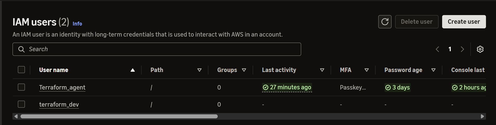

# Phase 0 – Secure AWS Setup

Before writing any infrastructure code, I secured the AWS account and created a
dedicated identity for Terraform. Each step records what I did, why, how, proof
that it worked, and what I learned.

## 0.1 Enable MFA on human identities

**What:** Enabled passkey-based MFA on the root user and on my IAM user (`Terraform_agent`).

**Why:** A leaked password alone should not give access to the account. The root
user can do anything (including closing the account), so it must be the
best-protected identity.

**How:**
Console → account name → Security credentials → Multi-factor authentication →
Assign MFA device → Passkey or security key → confirm with device unlock.
Repeated for my IAM user.

**Proof:** Both identities show an assigned passkey MFA device (2026-11-17).

**Lesson:** Passkeys are phishing-resistant: a fake login page cannot reuse them.
The automation user created next has no password, so its protection is keeping
the access key secret.

## 0.2 Create a dedicated automation user for Terraform

**What:** Created the IAM user `terraform-dev` with programmatic access only (no
console password), attached the `AdministratorAccess` policy, and created one
access key for CLI use.

**Why:** Terraform needs credentials to call AWS APIs. A separate identity means a
leaked key can be revoked without affecting my own login.

**How:**
IAM → Users → Create user → `terraform-dev` (console access disabled) →
Attach policies directly → `AdministratorAccess` → Security credentials →
Create access key → use case: Command Line Interface.

**Proof:** IAM lists `terraform-dev` with 1 active access key. The key file is
stored outside any Git repository.

**Lesson / trade-off:** `AdministratorAccess` is not least privilege. I accepted it
for a personal learning account protected by MFA and a budget alarm. In a company
I would use IAM Identity Center with short-lived credentials and a scoped role.