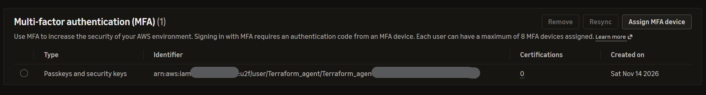

# Phase 0 – Secure AWS Setup

Before writing any infrastructure code, I secured the AWS account and created a
dedicated identity for Terraform. Each step records what I did, why, how, proof
that it worked, and what I learned.

## 0.1 Enable MFA on human identities

**What:** Enabled passkey-based MFA on the root user and on my IAM user (`Terraform_agent`).

**Why:** A leaked password alone should not give access to the account. The root
user can do anything (including closing the account), so it must be the
best-protected identity.

**How:**
Console → account name → Security credentials → Multi-factor authentication →
Assign MFA device → Passkey or security key → confirm with device unlock.
Repeated for my IAM user.

**Proof:** Both identities show an assigned passkey MFA device (2026-11-17).



**Lesson:** Passkeys are phishing-resistant: a fake login page cannot reuse them.
The automation user created next has no password, so its protection is keeping
the access key secret.

## 0.2 Create a dedicated automation user for Terraform

**What:** Created the IAM user `terraform-dev` with programmatic access only (no
console password), attached the `AdministratorAccess` policy, and created one
access key for CLI use.

**Why:** Terraform needs credentials to call AWS APIs. A separate identity means a
leaked key can be revoked without affecting my own login.

**How:**
IAM → Users → Create user → `terraform-dev` (console access disabled) →
Attach policies directly → `AdministratorAccess` → Security credentials →
Create access key → use case: Command Line Interface.

**Proof:** IAM lists `terraform-dev` with 1 active access key. The key file is
stored outside any Git repository.


**Lesson / trade-off:** `AdministratorAccess` is not least privilege. I accepted it
for a personal learning account protected by MFA and a budget alarm. In a company
I would use IAM Identity Center with short-lived credentials and a scoped role.

## 0.3 Store credentials in a named AWS CLI profile

**What:** Stored the `terraform-dev` access key in a local AWS CLI profile named
`terraform_dev` (region `us-east-1`, output `json`).

**Why:** Terraform code will reference only the profile name. The key itself stays
in `~/.aws/credentials`, outside the repository, so the code can be public safely.

**How:**
```bash
aws configure --profile terraform_dev
aws configure list-profiles
cat ~/.aws/config
```

**Proof:**
```text
[profile terraform_dev]
region = us-east-1
output = json
```

**Lesson:** `~/.aws/config` holds settings (safe to share); `~/.aws/credentials`
holds secrets (never share). In config the section is written [profile terraform_dev],
in credentials just [terraform_dev].

## 0.4 Verify the identity Terraform will use

**What:** Confirmed that the `terraform_dev` profile authenticates as the
`terraform-dev` IAM user.

**Why:** Before any infrastructure change, I verify which identity and account
will be used, to avoid deploying into the wrong account.

**How:**
```bash
aws sts get-caller-identity --profile terraform_dev
```

**Proof:** (account ID masked)
```json
{
  "UserId": "AIDA****************",
  "Account": "xxxxxxxxxxxx",
  "Arn": "arn:aws:iam::xxxxxxxxxxxx:user/terraform-dev"
}
```

**Lesson:** The Arn ending in user/terraform-dev proves the profile maps to the
correct identity. I will run this check before every terraform apply.

## 0.4b Remove long-lived keys from my console user

**What:** Deactivated the access key on my console user `Terraform_agent`, so
only the automation user `terraform-dev` holds an access key.

**Why:** Human identities should not hold long-lived access keys. Before this
change, a leaked key would have exposed the same identity I use to log in.

**How:** IAM → Users → Terraform_agent → Security credentials → Access keys →
Actions → Deactivate. Scheduled deletion after one week without issues.

**Proof:** `aws sts get-caller-identity` (default profile) now returns
`InvalidClientTokenId`; `--profile terraform_dev` still returns `user/terraform-dev`.

**Lesson:** Deactivate before delete: it is reversible, so I can safely confirm
nothing else depended on the key.