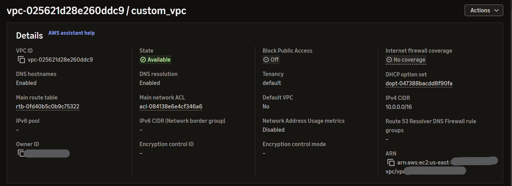

# Phase 1 – First Terraform Resource

In this phase I wrote my first Terraform configuration, created the project's
custom VPC in AWS, inspected Terraform's state, observed how plan symbols signal
risk, and destroyed the resource again.

## 1.1 Pin Terraform and provider versions

**What:** Created `versions.tf`, requiring Terraform 1.10 or newer and the
`hashicorp/aws` provider in the 6.x range.

**Why:** Without version pins, a new provider release could change behaviour and
break the configuration. Pins make every run reproducible, on any machine.

**How:**
```hcl
terraform {
  required_version = ">= 1.10.0"

  required_providers {
    aws = {
      source  = "hashicorp/aws"
      version = "~> 6.0"
    }
  }
}
```
Source: Registry → hashicorp/aws → USE PROVIDER, then edited the version
constraint (`~> 6.0` = any 6.x, never 7.0).

**Proof:** `terraform init` output:
```text
- Installed hashicorp/aws  v6.73.0 (signed by HashiCorp)
Terraform has been successfully initialized!
```

**Lesson:** `init` creates two things. `.terraform.lock.hcl` records the exact
provider version and is committed, so everyone uses the same one. `.terraform/`
holds the downloaded plugin (large, re-downloadable) and is ignored by Git.

## 1.2 Configure the AWS provider

**What:** Created `providers.tf` with region `us-east-1`, the AWS CLI profile
`terraform_dev`, and default tags applied to every resource.

**Why:** The provider needs to know where to build and as whom. Referencing a
profile name keeps credentials out of the code. Default tags make every resource
identifiable and allow cost tracking per project.

**How:**
```hcl
provider "aws" {
  region  = "us-east-1"
  profile = "terraform_dev"

  default_tags {
    tags = {
      Project   = "tf-capstone"
      ManagedBy = "terraform"
      Owner     = "lawrence"
    }
  }
}
```
Argument names from Registry → AWS Provider → Argument Reference; values from
the project brief (region), Phase 0 (profile) and my own tagging convention.

**Proof:** The plan showed all three default tags in `tags_all` (see 1.3).

**Lesson:** Words (argument names) come from the docs, values come from the
project. Terraform uses only the laptop profile, never my console login, so I
check it with `aws sts get-caller-identity --profile terraform_dev` before
every apply.

## 1.3 Create, inspect and destroy the custom VPC

**What:** Created the VPC `custom_VPC` (10.0.0.0/16, DNS support and DNS
hostnames enabled), as required by Task 1 of the brief.

**Why:** The VPC is the private network that will contain every other resource
in this project.

**How:**
```hcl
resource "aws_vpc" "custom_vpc" {
  cidr_block           = "10.0.0.0/16"
  enable_dns_support   = true
  enable_dns_hostnames = true

  tags = {
    Name = "custom_VPC"
  }
}
```
```bash
terraform init
terraform fmt
terraform validate
terraform plan
aws sts get-caller-identity --profile terraform_dev
terraform apply
terraform state list
terraform destroy
```

**Proof:**
```text
Plan: 1 to add, 0 to change, 0 to destroy.
aws_vpc.custom_vpc: Creation complete after Xs [id=vpc-025621d28e260ddc9]
Apply complete! Resources: 1 added, 0 changed, 0 destroyed.
Destroy complete! Resources: 1 destroyed.
```


**Lesson:** `enable_dns_hostnames` defaults to `false`, so the brief's
requirement only holds if I set it explicitly. `aws_vpc.custom_vpc` is
Terraform's internal address; `Name = "custom_VPC"` is the name AWS shows.
The state file (`terraform.tfstate`) is only created by `apply` and stays out
of Git because it contains account details.

## 1.4 Reading plan symbols

**What:** Ran two experiments to see how Terraform signals risk in a plan.

| Change | Symbol | Plan summary | Meaning |
|--------|--------|--------------|---------|
| Tag `Owner` changed | `~` | 0 to add, 1 to change, 0 to destroy | Updated in place; same VPC ID |
| `cidr_block` changed to 10.1.0.0/16 (plan only, reverted) | `-/+` | 1 to add, 0 to change, 1 to destroy | "forces replacement": AWS cannot change a VPC's CIDR, so Terraform would delete and recreate it |

**Lesson:** I read the plan summary line before every apply. `-/+` means
destroy and recreate, which in a real network would delete everything inside it.